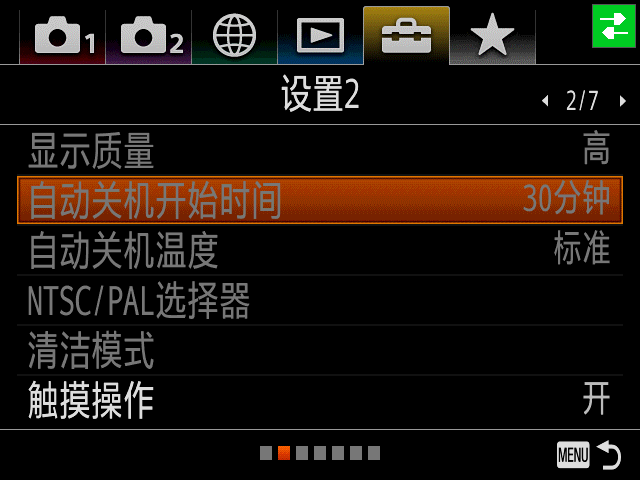
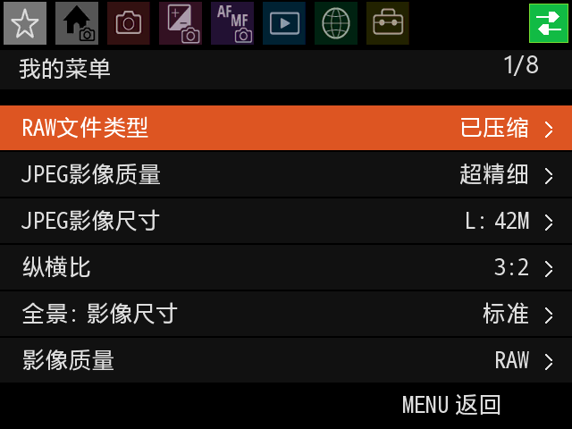
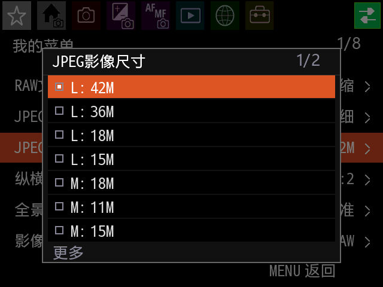
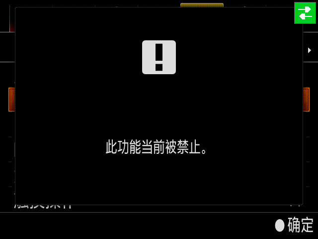

# a7r3-qemu

在 QEMU 里运行 **Sony A7R3（ILCE-7RM3）原厂固件**，并在此基础上研究一套
「A7C2 风格的新菜单叠层」：盖住原生 UI、不被原生渲染打断、能真正修改设置、支持触摸。

> **本仓库不包含任何 Sony 固件、eMMC 镜像、字体、图标或其它专有资产。**
> 运行需要你**自己合法获得**的固件；Sony / ILCE / A7R3 等商标归 Sony 所有。
> 详见 [NOTICE.md](NOTICE.md)。

---

## 1. 成果一览（均在 QEMU + 自备固件中实测）

| 能力 | 状态 | 证据 |
| --- | --- | --- |
| 原厂固件启动 + 原生 UI 显示 | ✅ | 自定义 `cxd90045` 机器模型 + Sugilite 2D 光栅化 |
| 按键注入（脚本/串口） | ✅ | OSAL 消息队列路径 |
| 新菜单叠层（640×480、中文） | ✅ | 写 panel + 两块 present 缓冲 |
| 不被原生 UI 重绘打断 | ✅ | 20 ms present 金丝雀 + 立即重画 |
| 显示真实设置名与真实值 | ✅ | 固件自带字体 + 自带字符串表 |
| 真正修改设置 | ✅ | `CmnViewSettingNode::setItemSelectedBySRNum` |
| 触摸（点选 / 切分类 / 开二级页） | ✅ | 轮询 `libObj+0x0129eb20` 的 (x, y) |
| 二级页面（选项弹窗） | ✅ | 点已选中的行 → 列出该行全部 SR 选项，点选即改值 |
| 新旧菜单切换按钮 | ✅ | 右上角 44x44 双箭头图标，两种状态下都在同一位置 |
| 关闭时交还原生画面 | ✅ | 打开前抓原生帧，关闭时回写（+ 20 ms 守卫） |
| 真机验证 | ⏳ | 需要一次真机会话（触摸尺度、60 fps 闪烁、MENU 键） |

## 2. 截图（QEMU 实拍，均为 640×480 面板）

| 原生菜单（旧） | 新菜单叠层 |
| --- | --- |
|  |  |

| 二级页面（选项弹窗） | 原生警告框（也可以在叠层下面正常显示） |
| --- | --- |
|  |  |

说明：右上角那个绿色双箭头是"新旧菜单切换"按钮，两种状态下都在同一位置。
原生菜单是**按键式**的（触摸只做对焦），所以网页里点旧菜单会被翻译成
"移动选择 + ENTER"。

## 3. 原理

```
启动：u-boot → Linux → initrd → /usr/bin/... → im.elf
         └─ 我们提供 cxd90045 机器模型（LCD / Sugilite 2D / eMMC / DDR）

显示：App 绘制 → grm_gles / Sugilite 2D → 0x202E0200（渲染目标）
      → present blit → 0x23A80000 / 0x23B16000（双缓冲）

叠层：/usr/tool/libefence.so（LD_PRELOAD 进 im.elf）
      ├─ 读设置树：CautionConfig.so 导出的 456 个 cmnViewSettingNodeRoot*
      ├─ 取文案：resid 0x02xxxxxx → 0x1E|low24 → string_simplifiedchinese.uxc
      ├─ 画文字：从固件 .ltt 容器抽出的 TrueType → 4-bit 字形图集
      ├─ 写画面：/dev/mem 写 0x202E0200 + 两块 flip 缓冲
      ├─ 改设置：setItemSelectedBySRNum(SR)（固件自己的 API）
      └─ 触摸：轮询 libObj+0x0129eb20 的 (x, y)
```

## 4. 仓库结构

```
payloads/            注入到相机进程里的 .so 源码
  menu_overlay.c       新菜单叠层（渲染/字符串/设值/触摸/自测）
  menu_shell.c         A7C2 风格界面绘制
  gpu_shim_qemu.c      LD_PRELOAD shim（GPU ioctl 观测、面板写、按键）
  probe_menu.c         M0 探针（读设置树、dump 节点/属性）
  scripts/             构建 / 安装脚本
qemu/
  bionz.c              cxd90045 机器模型（LCD/Sugilite 2D/eMMC/DDR 等）
tools/                 离线分析与解码工具（固件解包、UXC/字体、命令流、RAM dump）
docs/
  SUMMARY.md           做了什么 + 踩过的坑（推荐先读）
  FIRMWARE.md          怎么从你自己的相机 dump 固件（只读，仓库不含数据）
  A7R3_NOTES.md        完整技术笔记（公开版：已删除引导/恢复章节）
  HANDOFF.md           项目状态与工具索引
  images/              新旧菜单、二级页、警告框的截图
```

## 5. 快速开始

> 需要：Linux（WSL 可用）、QEMU 源码树、`clang`/`lld`（ARM 交叉）、Python 3 + Pillow，
> 以及**你自己的** A7R3 固件（eMMC 镜像、内核与 initrd）。
>
> 固件怎么来：见 **[docs/FIRMWARE.md](docs/FIRMWARE.md)** —— 从你自己的相机做**只读**
> 分区 dump、拼成 QEMU 用的 eMMC 镜像。仓库里不含任何固件数据。

1. 把 `qemu/bionz.c` 放进 QEMU 的 `hw/arm/`，并在 `hw/arm/Makefile.objs` 与
   `default-configs/arm-softmmu.mak` 里注册 `cxd90045` 机器（见 `qemu/README.md`）。
2. 用 `payloads/scripts/build-shim*.sh`、`build-newmenu.sh` 构建 payload。
3. 字体/图标等素材**不随仓库提供**：按 `docs/SUMMARY.md` 第 5 节从你自己的固件里生成。
4. 一条命令跑起来（QEMU + 网页实时画面，<http://localhost:8765/>）：

```bash
bash payloads/scripts/see-menu.sh 8765
```

命令行驱动画面（点按/按键/截图）：

```bash
python3 payloads/scripts/nm-drive.py click 600 20     # 右上角：进/出新菜单
python3 payloads/scripts/nm-drive.py click 300 248    # 旧菜单点行；再点一次 = ENTER
python3 payloads/scripts/nm-drive.py snap demo        # 存快照
python3 payloads/scripts/nm-inspect.py 6              # 最近 6 帧的"年龄/内容分/PNG"
```

## 6. 已知限制

- 只在 QEMU 中验证；真机差异（触摸坐标尺度、60 fps present 下的闪烁窗口、
  原生触控 AF 干扰）尚未验证。
- 叠层目前覆盖 8 分类 × 6 行 = 48 行（示例），456 项的原生分页数据尚未解出，
  分类归属是按名字近似映射。
- 物理 MENU 键的"返回"用"原生 present"间接判定：真机按下 MENU 会触发原生重绘，
  这条路径还没在真机验证；确定可用的是页脚"MENU 返回"、右上角按钮与 `b` 通道。
- **原生菜单是按键式 UI**（触摸只用于对焦），所以网页里点旧菜单必须由宿主翻译成
  按键（移动选择 + ENTER）；`/nmclick` 在叠层关闭时会自动走这条路。
- **看到"黑屏"先确认抓的是哪一块缓冲**：App 是双缓冲 present，警告对话框这类视图
  只落在其中一块上。模型现在每 tick dump 三块（渲染目标 + 两块 present），网页取
  "最新的非全黑帧"，所以对话框能正常显示（`payloads/scripts/patch-bionz-3pa.py`）。
- 反复强杀 QEMU 会把 guest `/tmp` 的 FAT 写脏 → 只读挂载 → 叠层的 `/tmp` 通道失效，
  用 `payloads/scripts/fsck-guest-tmp.sh fix` 修（`see-menu.sh` 启动时会自动查/修）。
- 不提供任何绕过设备保护措施的内容（引导链/恢复通道章节已删除）。

## 7. 引用与致谢

本项目的部分代码来自公开研究，**必须保留其署名与许可证**：

| 来源 | 许可证 | 用在哪 |
| --- | --- | --- |
| [cokeenet/zve10-qemu](https://github.com/cokeenet/zve10-qemu) | **PolyForm Noncommercial 1.0.0** | `payloads/menu_shell.{c,h}` 是派生作品 ⇒ **含这两个文件的构建仅限非商业使用** |
| [Derek2011cc/A7M3-Firmware-QEMU-Boot-Experiment](https://github.com/Derek2011cc/A7M3-Firmware-QEMU-Boot-Experiment) | MIT | `qemu/bionz.c` 的 Sugilite 2D 软件光栅化 |
| [QEMU](https://www.qemu.org/) | GPL-2.0 | 机器模型的宿主 |
| [ma1co/Sony-PMCA-RE](https://github.com/ma1co/Sony-PMCA-RE) | MIT | `tools/real-device/` 的外部依赖（未随仓库分发） |

还有一批提供思路与资料的仓库（a7c2-qemu、a7m3-qemu、Sony_A7M3 等），
完整清单、作者与许可证见 **[CREDITS.md](CREDITS.md)**。

## 8. 法律与合规

本项目仅用于**互操作性研究**与**自有设备**的界面实验：

- 不含 Sony 固件或任何专有资产，不提供下载；
- **截图**（`docs/images/`）是在自有设备的模拟环境里抓的界面图，仅作研究说明/评论用途，
  界面设计与相关商标归 Sony 所有；
- 不要在未授权设备上使用；不要用于绕过版权保护或签名校验；
- 反编译/分析在部分司法辖区受当地法律与许可协议约束，使用前请自行确认合规；
- 因使用本仓库导致的任何后果由使用者自负。

详见 [NOTICE.md](NOTICE.md)。
